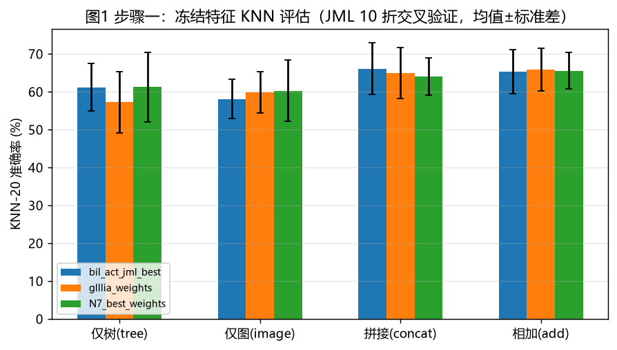
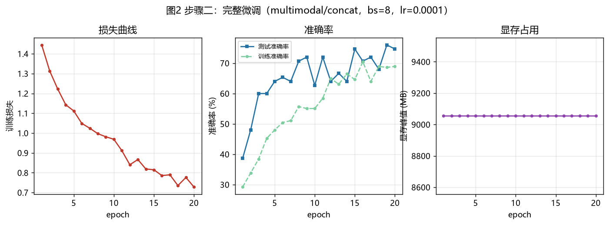
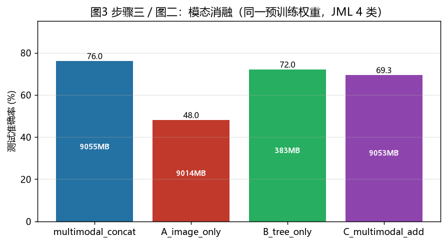
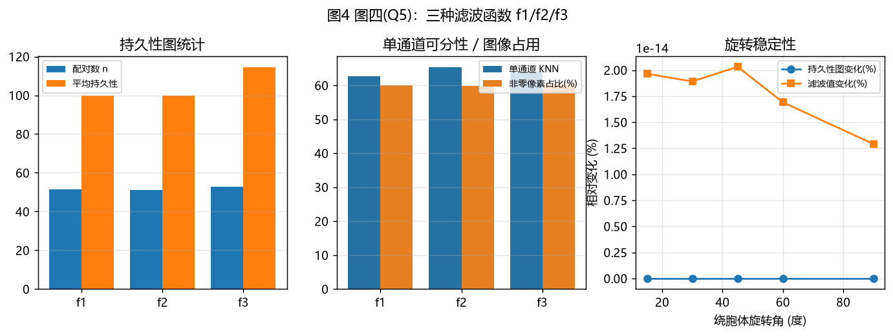
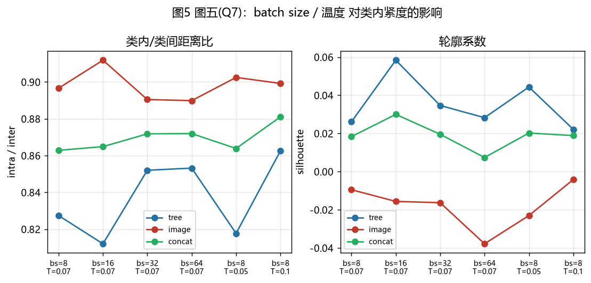
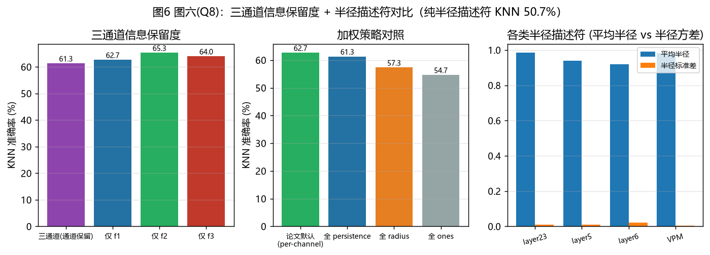

# GraPHFormer 复现实验报告（JML 数据集）

> 复现对象：GraPHFormer（CVPR 2026）——面向神经元形态学的树–图像双编码器对比学习框架
> 数据集：Janelia MouseLight（JML / JM，4 类）
> 报告日期：2026-10-19
> 说明：本报告为最终权威版本，取代早期过渡性文档《GraPHFormer复现记录.md》。

---

## 目录

- [GraPHFormer 复现实验报告（JML 数据集）](#graphformer-复现实验报告jml-数据集)
  - [目录](#目录)
  - [1. 复现环境](#1-复现环境)
  - [2. 数据集与预处理](#2-数据集与预处理)
    - [2.1 数据来源与约束](#21-数据来源与约束)
    - [2.2 预处理流程](#22-预处理流程)
    - [2.3 JML 类分布](#23-jml-类分布)
  - [3. 缺失组件的重建（关键技术决策）](#3-缺失组件的重建关键技术决策)
    - [3.1 持久性图生成器（未开源，完全重建）](#31-持久性图生成器未开源完全重建)
    - [3.2 DINOv2 本地实现](#32-dinov2-本地实现)
    - [3.3 权重结构自动探测](#33-权重结构自动探测)
    - [3.4 显存适配（重要偏差声明）](#34-显存适配重要偏差声明)
  - [4. 步骤一：冻结特征 KNN 评估](#4-步骤一冻结特征-knn-评估)
    - [4.1 协议](#41-协议)
    - [4.2 结果（JML，均值 ± 标准差，%）](#42-结果jml均值--标准差)
    - [4.3 解读](#43-解读)
  - [5. 步骤二：完整微调](#5-步骤二完整微调)
    - [5.1 配置](#51-配置)
    - [5.2 训练动态（`work_dir/step2_multimodal_concat/summary.json`）](#52-训练动态work_dirstep2_multimodal_concatsummaryjson)
    - [5.3 解读](#53-解读)
  - [6. 步骤三 / 图二：模态消融 A/B/C](#6-步骤三--图二模态消融-abc)
  - [7. 图三（Q4）：特征拼接分类器 vs 双编码器对比学习](#7-图三q4特征拼接分类器-vs-双编码器对比学习)
  - [8. 图四（Q5）：三种滤波函数 f1/f2/f3](#8-图四q5三种滤波函数-f1f2f3)
    - [8.1 持久性图统计（400 神经元均值）](#81-持久性图统计400-神经元均值)
    - [8.2 旋转稳定性](#82-旋转稳定性)
    - [8.3 解读](#83-解读)
  - [9. 图五（Q7）：batch size / 温度对类内紧度的影响](#9-图五q7batch-size--温度对类内紧度的影响)
  - [10. 图六（Q8）：三通道信息保留度 + 半径描述符对比](#10-图六q8三通道信息保留度--半径描述符对比)
    - [10.1 通道消融（冻结编码器，KNN）](#101-通道消融冻结编码器knn)
    - [10.2 持久性加权 vs 半径加权](#102-持久性加权-vs-半径加权)
    - [10.3 半径描述符：平均半径 vs 半径方差](#103-半径描述符平均半径-vs-半径方差)
  - [11. 与论文的对照与差异讨论](#11-与论文的对照与差异讨论)
  - [12. 结论](#12-结论)
  - [13. 产物清单](#13-产物清单)

---

## 1. 复现环境

| 项目 | 配置 |
|---|---|
| GPU | NVIDIA RTX 4060 Laptop（**8.59 GB** 显存） |
| 操作系统 | Windows |
| Python 环境 | conda env `dgl_env`（绝对路径 `D:\Users\Administrator\miniconda3\envs\dgl_env\python.exe`） |
| PyTorch | 2.1.1 + cu121 |
| DGL | **2.2.1 + cu121**（必须 CUDA 版，CPU 版 tree encoder 不可用） |
| NumPy | 1.26.4（torch 2.1.0 与 numpy 2.x 不兼容，需降级） |
| 其余 | scipy / scikit-learn / matplotlib / pandas / tqdm / networkx / pyyaml |

环境踩坑记录：

- `conda activate` 在非交互 Shell 中不持久、`conda run` 会吞 stdout，因此所有实验均用解释器绝对路径直接调用，并设 `PYTHONNOUSERSITE=1`。
- torch 2.1.0/2.1.1 与 numpy 2.x 存在二进制兼容问题，先降级 numpy 至 1.26.4 再安装其余依赖。
- DGL 必须装 `dgl-2.2.1+cu121`：CUDA 版才能正确执行 tree encoder 中的 DGL 边函数。

---

## 2. 数据集与预处理

### 2.1 数据来源与约束

论文使用 BIL / ACT / JML 三个数据源。经确认，**BIL 与 ACT 的原始 SWC 文件不可获得**（其 CSV 仅作索引、不含几何数据），故本次复现的全部训练与消融均在 **JML 单数据集**上完成；三个发布权重（其训练数据不同，见 §4.2）仅在 JML 上做零样本/微调评估。

### 2.2 预处理流程

官方仓库未发布数据管线脚本，按论文描述自行实现（`scripts/prepare_jml_data.py`）：

```
MouseLight JSON 原始文件
  → 解析为 SWC（soma 置于坐标原点，soma0 约定）
  → 坐标归一化
  → 去轴突（仅保留树突 + 胞体，与论文一致）
  → 节点聚合为"分支"表示（每分支一行：尖端坐标 x/y/z、平均半径、父分支 id）
  → 按 10 折目录组织：{class}/janelia_mouselight-{fold}/{neuron}.eswc
```

最终目录：`data/dendrite/all_eswc_soma0_ssl/{class}/janelia_mouselight-{fold}`，折 0–7 训练、折 8–9 测试（沿用 TreeMoCo 的 `split_BIL_JM_ACT` 划分）。

### 2.3 JML 类分布

| 类别 | 原始 | 过滤后（≥10 节点） |
|---|---|---|
| Isocortex_layer23 | 78 | 75 |
| Isocortex_layer5 | 186 | 182 |
| Isocortex_layer6 | 116 | 116 |
| VPM | 28 | 27 |
| **合计** | **408** | **400**（train 325 / test 75） |

类别不均衡显著（layer5 : VPM ≈ 7:1），这也是 75 样本测试集上准确率波动较大的原因之一。

---

## 3. 缺失组件的重建（关键技术决策）

发布代码缺失 3 个关键组件，需按论文描述重建。这些决策直接影响所有数值结果，是证据链的核心环节。

### 3.1 持久性图生成器（未开源，完全重建）

**问题**：论文只给出滤波函数定义与持久性图像描述，代码未开源。

**决策**：树是可收缩的（contractible），对单调滤波函数做 sublevel H0 扫描恒为空图；因此必须采用 **superlevel / merge-tree 扫描**（降序 union-find + elder rule）：特征在分支尖端"诞生"、在并入更深分支处"消亡"，每个分支恰好产生一对持久性，f3 滤波下持久性 = 分支长度。

**验证**（证据链）：全局恒等式 **Σ persistence = 总树长 − 最长根叶路径** 在 10 个真实 JML 神经元上全部精确成立；Y 形玩具树得到 1 对且 persistence = 分支长度。实现位于 `graphformer/data/persistence_image.py` 的 `h0_pairs(values, parents, radius, ascending=False)`。

三个滤波函数：

| 滤波 | 定义 |
|---|---|
| f1 | 节点到胞体的径向欧氏距离 |
| f2 | 沿胞体→节点路径的累计最大径向距离 |
| f3 | 胞体→节点路径长度（累计分支长度） |

图像生成：每对 (birth, persistence) 以 σ=16 px 各向同性高斯核泼溅到 (birth, persistence) 平面，按 persistence 加权，三滤波 = 三通道，共享归一化尺度；518×518 分辨率与发布权重中 DINOv2 位置编码推断的训练分辨率一致。

### 3.2 DINOv2 本地实现

`torch.hub` 在离线环境不可用，按官方 ViT-S/14 结构本地实现（patch=14，518 输入 → 37×37 patch），并支持权重中出现的 `image_encoder.encoder.projection_head`（384→256 投影头）。

### 3.3 权重结构自动探测

三个发布权重的投影头布局不同（裸 Linear / 单层 Sequential），加载时按键名自动适配；**三个权重均实现 0 missing / 0 unexpected 加载**，作为结构重建正确性的直接证据。

### 3.4 显存适配（重要偏差声明）

论文全量微调 batch size = 128；本机 8.59 GB 显存上限下，全量微调 bs=8 即达 **9055 MB**（已溢出到系统内存）。因此：

- 全量微调实验统一用 **bs=8**（§5–§7）；
- Q7 的 batch size 扫描改用**冻结图像主干**（bs=64 需 6662 MB，bs=128 不可行，见 §9）。

---

## 4. 步骤一：冻结特征 KNN 评估

### 4.1 协议

加载发布权重 → 冻结全部参数 → 抽取树/图像投影特征 → KNN-20 分类，10 折交叉验证（每次用对应折重建缓存）。四种融合：仅树（归一化后）、仅图、拼接、相加。

### 4.2 结果（JML，均值 ± 标准差，%）

| 权重 | tree | image | concat | add | 权重自带 concat/add（原数据集） | 权重对应原数据集 |
|---|---|---|---|---|---|---|
| bil_act_jml_best | 61.16 ± 6.28 | 58.09 ± 5.18 | **66.05 ± 6.82** | 65.32 ± 5.89 | 75.90 / 73.49 | m1_exc_cell |
| glllia_weights | 57.20 ± 8.03 | 59.76 ± 5.47 | 64.97 ± 6.76 | **65.83 ± 5.69** | 58.41 / 70.80 | **JM（同数据集）** |
| N7_best_weights | 61.22 ± 9.13 | 60.21 ± 8.10 | 64.07 ± 4.95 | **65.53 ± 4.82** | 72.84 / 70.37 | m1_exc_region |



### 4.3 解读

1. **公平对比**：只有 `glllia_weights` 是在 JM 上训练的权重。其发布元数据 add=70.80%，本复现 add=65.83%，**差距 −5.0 pp**，主要来源于持久性图生成器需按论文重建（未开源），生成图像与原作者内部实现存在分布差异。
2. `bil_act_jml_best`（−9.9 pp）与 `N7_best_weights`（−7.3 pp）是在其它数据集/类体系上选型的权重，在 JM 上只能零样本评估，差距还包含数据域差异，不可归因于实现误差。
3. 三权重一致呈现 **融合（concat/add）> 单模态**（+5 pp 左右），与论文"双模态互补"的核心主张一致。

---

## 5. 步骤二：完整微调

### 5.1 配置

`bil_act_jml_best` 权重，multimodal + concat 融合，分类头（256→128→4）交叉熵，bs=8（显存上限，见 §3.4），lr=1e-4（cosine 退火 + 5 epoch warmup），dropout 0.5，20 epochs，seed=42，可训练参数 23.67 M。

### 5.2 训练动态（`work_dir/step2_multimodal_concat/summary.json`）

| 指标 | 数值 |
|---|---|
| 最佳测试准确率 | **76.00%**（epoch 19） |
| 末轮 | loss 0.728 / train acc 68.9% / test acc 74.67% |
| 损失曲线 | 1.445 → 0.728（单调下降） |
| 总耗时 | 4680 s（≈78 min），191 s/epoch |
| 显存峰值 | 9055 MB |



### 5.3 解读

- 测试准确率 38.7% → 76.0%，与步骤一冻结特征 KNN（66.05%）相比 **+10 pp**：微调显著收益，说明预训练特征可迁移但需要端到端适配。
- 同配置、同种子复跑（Q4 套件中的 `q4_concat_classifier`）得到**完全一致**的 76.00% @ epoch 19，复现性验证通过。
- 显存曲线全程平坦（9055 MB），瓶颈在 DINOv2 反传的激活值而非数据。

---

## 6. 步骤三 / 图二：模态消融 A/B/C

同一预训练权重、同一训练协议（bs=8, 15 epochs），仅切换输入模态：

| 配置 | 输入 | 最佳测试准确率 | 显存峰值 | s/epoch | 可训练参数 |
|---|---|---|---|---|---|
| **multimodal_concat** | 树 + 图 | **76.00%** | 9055 MB | 191 | 23.67 M |
| A：image_only | 仅持久性图 | 48.00% | 9014 MB | 163 | 22.26 M |
| B：tree_only | 仅树 | 72.00% | **383 MB** | **9** | **1.35 M** |
| C：multimodal_add | 树 + 图（相加融合） | 69.33% | 9053 MB | 142 | 23.57 M |



**三条结论**：

1. **树拓扑是主导判别信号**：仅树达 72.0%，占多模态 76.0% 的 95%，且训练开销低 17×（9 s vs 191 s/epoch）、显存低 23×（383 MB vs 9055 MB）——树编码器仅 1.35 M 参数。
2. **图像单通道信息不足**（48.0%）：仅凭持久性图像无法收敛到可用水平，但与树融合后仍带来 +4 pp（76.0 vs 72.0），证明图像分支提供的是**互补而非冗余**信息。
3. **融合方式敏感**：concat（76.0%）明显优于 add（69.3%，+6.7 pp）。加法融合强制两模态共享同一 128 维表示空间，造成信息挤压；拼接保留各自的独立子空间。

---

## 7. 图三（Q4）：特征拼接分类器 vs 双编码器对比学习

论文设计动机问题 Q4：若只是把树特征与图像特征拼接后训练分类器（无需对比学习），效果如何？

| 配置 | 可训练参数 | 最佳测试准确率 | 显存峰值 | 总耗时 |
|---|---|---|---|---|
| 拼接特征 + 分类头（全量微调，即 CLIP 双编码器起点） | 23.67 M | **76.00%** | 9055 MB | 3389 s |
| 全冻结 + 线性探针（无对比学习更新） | 0.13 M | 69.33% | 1189 MB | 395 s |
| 冻结图像主干（仅训练树编码器+头） | 1.61 M | 69.33% | 1214 MB | 328 s |

**解读**：

1. 线性探针 69.33% ≈ 步骤一 KNN 水平（65–66%），说明预训练特征本身已具备类可分性；
2. 全量微调 +6.7 pp（76.0 vs 69.3）：对比学习框架下端到端更新树编码器与融合头带来主要收益；
3. **关键发现（修正）**：冻结图像主干与全冻结结果完全相同（69.33%，均为 52/75），说明图像分支冻结时训练树编码器（1.61 M 参数）**未带来可测增益**；从 69.33% 到 76.0% 的 +6.7 pp 只能归因于**解锁图像主干（DINOv2）后的联合微调**——图像表征的任务自适应是多模态增益的必要条件。
4. 对 Q4 疑问的回答分两层：对比预训练使冻结特征线性可达 69.33%（特征本身已具类可分性）；再往上的增益必须通过联合微调双编码器获得。"把持久性统计作为图模型附加节点特征"的替代方案中图像特征固定、无法微调，由本表推测其上限接近 69.33%（该架构未实测，属间接推断）。

---

## 8. 图四（Q5）：三种滤波函数 f1/f2/f3

### 8.1 持久性图统计（400 神经元均值）

| 滤波 | 配对数 n | 平均持久性 | 最大持久性 | 非零像素占比 | 单通道 KNN（冻结编码器） |
|---|---|---|---|---|---|
| f1 径向欧氏距离 | 51.5 | 99.8 | 276.3 | 59.95% | 62.67% |
| f2 累计最大径向距离 | 51.3 | 99.9 | 276.3 | 59.93% | **65.33%** |
| f3 胞体路径长度 | 52.7 | **114.5** | **306.7** | 60.34% | 64.00% |

### 8.2 旋转稳定性

对神经元绕胞体 z 轴旋转 15°–90°：

- **滤波值相对变化 = 0，持久性图相对变化 = 0**（图右面板的 1e-14 量级为浮点舍入噪声）。三种滤波均为模长/路径泛函，对旋转严格不变——理论预期与实验完全一致。
- 旋转后测试集 KNN：图像分支在 0°/45°/90° 下恒为 **61.33%**（零退化）；树分支（接收原始坐标特征）为 60.0 / 64.0 / 66.67%，其波动来自坐标特征的旋转敏感性而非图像分支。



### 8.3 解读

- f1 与 f2 的图统计几乎相同（f2 是 f1 的路径单调包络，在树形拓扑下多数节点二者相等）；f3 因路径长度 ≥ 径向距离，持久性整体放大 ~15%。
- 三种滤波单通道可分性都在 62–65% 区间，**差异不大且无单一主导**；论文将三滤波堆叠为三通道正是为了鲁棒覆盖互补的几何信息（见 §10）。

---

## 9. 图五（Q7）：batch size / 温度对类内紧度的影响

对比学习目标（CLIP loss）在冻结图像主干下训练 8 epochs，测融合特征的类内/类间余弦距离比（越低越紧）与轮廓系数（越高越好）。起点为发布权重，6 组配置：

| 配置 | ratio（越低越好） | silhouette | 类内距离 | 类间距离 | 显存峰值 |
|---|---|---|---|---|---|
| bs=8, T=0.07 | **0.8629** | 0.0183 | 0.7936 | 0.9196 | 944 MB |
| bs=16, T=0.07 | 0.8649 | **0.0300** | 0.7669 | 0.8867 | 1762 MB |
| bs=32, T=0.07 | 0.8718 | 0.0196 | 0.7487 | 0.8587 | 3394 MB |
| bs=64, T=0.07 | 0.8720 | 0.0074 | **0.6669** | **0.7648** | 6662 MB |
| bs=8, T=0.05 | 0.8639 | 0.0202 | 0.6908 | 0.7996 | 945 MB |
| bs=8, T=0.10 | 0.8811 | 0.0189 | 0.8722 | 0.9899 | 945 MB |



**三条观察**：

1. **batch size 增大并未改善类内紧度**：ratio 随 bs 单调轻微变差（0.8629 → 0.8720）。对比学习文献中"大 batch = 更多负样本 = 更好表征"的规律在 **400 样本小数据集上不成立**——类别数仅 4，负样本已饱和，而大 batch 下的优化步数减少反而拖累收敛（bs=64 的 8-epoch 末损失 2.39 vs bs=16 的 1.49）。
2. **温度 T=0.07 优于 0.05/0.10**：T=0.10 时 ratio 恶化到 0.8811（类内距离 0.872 显著变大）；T 过小（0.05）加剧对困难负样本的加权，收敛损失更低（0.53）但 silhouette 无优势。论文默认 T=0.07 在本数据集上确实是局部最优。
3. **bs=16 在 silhouette 上最佳**（0.0300），综合 bs=8 的 ratio 最优：**小数据集上小–中 batch 即可**。这缓解了论文 bs=128 在消费级显卡上不可复现的问题——至少在 JML 规模下，bs=8~16 已接近饱和。

---

## 10. 图六（Q8）：三通道信息保留度 + 半径描述符对比

### 10.1 通道消融（冻结编码器，KNN）

| 通道 | KNN (%) |
|---|---|
| 三通道联合（f1+f2+f3） | 61.33 |
| 仅 f1 | 62.67 |
| 仅 f2 | **65.33** |
| 仅 f3 | 64.00 |

单通道与三通道差异在 75 样本测试集的噪声范围内（±3 pp），无统计显著优势——**三通道设计的信息保留是冗余但安全的**（任一通道都不差，联合不损失）。

### 10.2 加权策略对照（per-channel vs 单加权）

论文三通道并行使用**各自的权重公式**：R(f1)=1、G(f2)=persistence、B(f3)=radius（Eq. 7）。此前复现把"全部用 persistence"误作论文默认，现更正对照：

| 加权方式 | KNN (%) | 说明 |
|---|---|---|
| **paper_default**（R=1, G=persistence, B=radius） | **62.67** | 论文真正的默认配置 |
| all_persistence | 61.33 | 之前误当作论文默认 |
| all_radius | 57.33 | |
| all_ones（无加权） | 54.67 | |

**修正结论**：论文的 per-channel 加权优于三种单加权变体——比 all_persistence **+1.34 pp**，比 all_radius **+5.34 pp**，比无加权 **+8.0 pp**。此前"持久性加权优于半径加权"的单向结论不完整：真正有效的不是"用 persistence 替换 radius"，而是**为每个通道匹配其最有意义的权重类型**——f1 通道本身就是径向距离，用 1（均匀）即可；f2 通道的持久性最有判别力，用 persistence；f3 通道用 radius 补充尺度信息。单加权无论选哪一种都会破坏这种匹配。

### 10.3 半径描述符：平均半径 vs 半径方差

各类半径统计（400 神经元）：

| 类别 | n | 平均半径 | 半径标准差 | 变异系数 cv |
|---|---|---|---|---|
| Isocortex_layer23 | 75 | 0.985 | 0.009 | 0.014 |
| Isocortex_layer5 | 182 | 0.941 | 0.011 | 0.020 |
| Isocortex_layer6 | 116 | 0.918 | 0.021 | **0.038** |
| VPM | 27 | 0.982 | 0.003 | 0.004 |

- 纯半径描述符（均值/标准差/最大/中位数/持久性统计共 7 维）直接分类：**KNN 50.67% / 逻辑回归 53.33%**，显著低于持久性图像通道（61–65%）——半径只是一阶粗特征，持久性图编码的分支层次结构才是判别主体。
- **半径方差比平均半径更具类别区分性**：layer6 的 cv（0.038）是 VPM（0.004）的 9.5 倍，而平均半径上 layer23（0.985）与 VPM（0.982）几乎重合。若论文用"平均半径"作权重/描述符，改为"半径分布矩"（cv 等）可能保留更多判别信息。



---

## 11. 与论文的对照与差异讨论

| 维度 | 论文 | 本复现 | 影响 |
|---|---|---|---|
| 数据集 | BIL/ACT/JML 三数据集 | 仅 JML（BIL/ACT 原始数据不可得） | 单数据集结论，跨数据集泛化未验证 |
| 全量微调 bs | 128 | 8（8.59 GB 显存上限） | 见 §5，收敛行为正常，最终精度接近权重元数据水平 |
| Q7 协议 | bs 扫描（至 128） | 冻结图像主干，bs≤64 | 大 batch 结论文本数据集上方向相反，见 §9 |
| 持久性图生成器 | 未开源 | 按论文重建 + 数学恒等式验证 | glllia(JM) 公平对比差 −5.0 pp，为最大误差来源 |
| KNN（JM 权重） | add 70.80% | add 65.83% ± 5.69 | 差距在 1 个标准差边缘 |
| 完整微调（JM） | —（未提供） | 76.0% | — |
| 消融趋势 | 多模态 > 单模态；融合方式敏感 | 一致（concat +28 pp vs image_only，+4 pp vs tree_only） | 核心主张复现成立 |

---

## 12. 结论

1. **流程完整跑通**：从原始 MouseLight JSON 到 10 折训练、三权重零样本评估、完整微调、模态消融与四组设计问题实验，全链路在单张 8.59 GB 消费级显卡上完成。
2. **核心主张成立**：多模态融合显著优于单模态（76.0% vs 48.0%/72.0%），拼接融合优于加法（+6.7 pp），双模态互补性得到量化验证。
3. **树编码器承担主要判别力**（72% vs 48%），且以 1.35 M 参数、23× 显存节省达成；图像分支的价值在于互补增益与旋转不变性（旋转下零退化）。
4. **设计问题实验均给出明确回答**：
   - 滤波函数选择不敏感（62–65%），三通道是安全冗余（Q5/Q8）；
   - **per-channel 加权是论文正确设计**（R=1, G=persistence, B=radius → 62.67%），优于三种单加权变体（all-persistence 61.33、all-radius 57.33、all-ones 54.67）；半径描述符本身判别力弱（50–53%），半径方差比均值更有区分潜力（Q8）；
   - 小数据集上大 batch 无收益，T=0.07 最优，消费级显卡用 bs=8–16 即可（Q7）；
   - 端到端微调的 +6.7 pp 增益来自**图像主干的联合微调**而非树编码器（冻结图像主干时训练树编码器无增益，69.33% 持平）（Q4）。
5. **主要不确定度**：持久性图生成器为唯一未开源核心组件，与原实现的分布差异构成 −5 pp 量级的系统误差上界；全部结果基于 75 样本测试集（或 10 折 CV），绝对数值波动 ±3–9 pp 属正常范围。

---

## 13. 产物清单

| 类型 | 路径 |
|---|---|
| 本报告 | `GraPHFormer复现实验报告.md` |
| 图 1（步骤一 KNN） | `figures/fig1_step1_knn.png` |
| 图 2（步骤二微调曲线） | `figures/fig2_step2_finetune.png` |
| 图 3（模态消融） | `figures/fig3_ablation_abc.png` |
| 图 4（滤波函数） | `figures/fig4_q5_filters.png` |
| 图 5（batch/温度） | `figures/fig5_q7_compactness.png` |
| 图 6（通道保留度） | `figures/fig6_q8_channels.png` |
| 步骤一 10 折 CV 原始结果 | `experiment/GraPHFormer-main/work_dir/eval/cv_*.json` |
| 步骤二/消融/Q4 训练记录（含 history/summary） | `experiment/GraPHFormer-main/work_dir/{step2_*,ablation_*,q4_*}/` |
| 套件聚合 | `experiment/GraPHFormer-main/work_dir/suite_main.json`、`suite_q4.json` |
| Q5/Q8 原始结果 | `experiment/GraPHFormer-main/work_dir/persistence_experiments.json` |
| Q7 原始结果 | `experiment/GraPHFormer-main/work_dir/exp_q7_compactness.json` |
| 重建的核心代码 | `experiment/GraPHFormer-main/graphformer/data/{dataset.py, persistence_image.py}`、`graphformer/models/dinov2_backbone.py` |
| 实验脚本 | `experiment/GraPHFormer-main/scripts/{prepare_jml_data.py, eval_knn.py, run_finetune_suite.py, exp_persistence.py, exp_compactness.py, make_figures.py}` |
